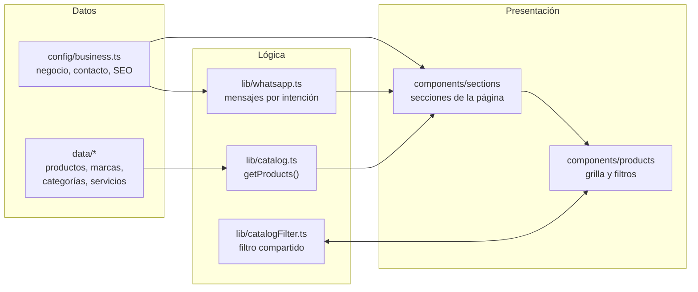
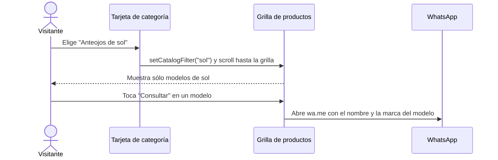

# Optinet Óptica — Vidriera digital

[](https://nextjs.org/)
[](https://react.dev/)
[](https://www.typescriptlang.org/)
[](https://tailwindcss.com/)

Sitio web de **Optinet Óptica**, una óptica de Las Parejas (Santa Fe, Argentina). Funciona como una
vidriera digital: presenta el negocio, muestra productos y servicios y lleva cada consulta a WhatsApp
con un mensaje ya preparado.

No es una tienda online. No tiene carrito, pagos, usuarios ni backend: es un sitio estático, rápido y
fácil de mantener, pensado para que una persona conozca la óptica y se comunique en un par de clics.

## Contenido

- [Características](#características)
- [Stack tecnológico](#stack-tecnológico)
- [Arquitectura](#arquitectura)
- [Estructura del proyecto](#estructura-del-proyecto)
- [Requisitos previos](#requisitos-previos)
- [Instalación y ejecución](#instalación-y-ejecución)
- [Personalización](#personalización)
- [Rendimiento, accesibilidad y SEO](#rendimiento-accesibilidad-y-seo)
- [Seguridad](#seguridad)
- [Despliegue en Vercel](#despliegue-en-vercel)
- [Datos pendientes de la demo](#datos-pendientes-de-la-demo)
- [Autor](#autor)

## Características

- **Página única por secciones:** inicio, categorías, productos, servicios, nosotros, Instagram y
  contacto, con navegación que resalta la sección visible.
- **Catálogo filtrable:** 16 productos de demostración en 5 categorías (sol, recetados, armazones,
  lentes y accesorios). Al tocar una categoría se filtra la grilla y la página baja hasta los productos,
  sin recargar.
- **Consultas por WhatsApp con contexto:** cada botón arma un mensaje distinto según el producto, el
  servicio o la consulta general. Por ejemplo: *"Vi en la web el modelo Aurora de Solaris y quería
  consultar por disponibilidad"*.
- **Contacto completo:** WhatsApp, Instagram, dirección, horarios, mapa de Google Maps embebido y
  enlace "Cómo llegar".
- **Header adaptable:** transparente sobre el hero y convertido en una barra flotante al hacer scroll.
  En mobile abre un menú a pantalla completa.
- **Animaciones suaves:** aparición de elementos al hacer scroll, microinteracciones en tarjetas y
  botones, y respeto por la preferencia de movimiento reducido del sistema.
- **Diseño responsive:** layouts específicos para mobile, tablet y desktop; en mobile las categorías
  se recorren como carrusel con scroll-snap.
- **Inicio siempre arriba:** al recargar o abrir un enlace con `#sección`, la página arranca desde el
  inicio.

## Stack tecnológico

| Área | Tecnología | Uso en el proyecto |
| --- | --- | --- |
| Framework | [Next.js 16](https://nextjs.org/) (App Router) | Renderizado estático, optimización de imágenes y fuentes, metadata |
| UI | [React 19](https://react.dev/) | Componentes de servidor por defecto; cliente sólo donde hay interacción |
| Lenguaje | [TypeScript 5](https://www.typescriptlang.org/) (modo `strict`) | Tipado de datos del catálogo y componentes |
| Estilos | [Tailwind CSS 4](https://tailwindcss.com/) | Tokens de marca en CSS, utilidades propias (`container-site`, `eyebrow`) |
| Animaciones | [Motion](https://motion.dev/) | Animaciones al hacer scroll con `LazyMotion` para cargar sólo lo necesario |
| Íconos | [Lucide](https://lucide.dev/) | Íconos de interfaz (los de WhatsApp e Instagram son SVG propios) |
| Tipografías | Sora y Plus Jakarta Sans vía `next/font` | Fuentes autoalojadas, sin pedidos a Google en el navegador |
| Calidad | ESLint (`eslint-config-next`) y `tsc --noEmit` | Lint y chequeo de tipos |

**Servicios externos:** WhatsApp (enlaces `wa.me`), Instagram (enlaces al perfil) y Google Maps (mapa
embebido e indicaciones). No hay base de datos ni API propia.

## Arquitectura

El proyecto separa **datos**, **lógica** y **presentación**. Los componentes no contienen textos de negocio
ni productos escritos a mano: los leen de `config/` y `data/` a través de `lib/`.



### Decisiones principales

- **Servidor por defecto, cliente donde hace falta.** Hero, servicios, contacto y footer se renderizan en
  el servidor. Sólo son componentes de cliente el header y el menú móvil, el explorador de productos y
  los envoltorios de animación.
- **Capa de acceso al catálogo.** Los componentes consumen `getProducts()` de `src/lib/catalog.ts`.
  Para conectar un catálogo real (API o CMS) alcanza con cambiar esa función respetando el tipo
  `Product` de `src/types/catalog.ts`.
- **Filtro sin dependencias.** Las tarjetas de categoría y la grilla de productos comparten un store
  mínimo basado en `useSyncExternalStore`, sin librerías de estado externas.
- **Mensajes de WhatsApp tipados.** `getWhatsAppUrl()` recibe una intención (`general`, `product`,
  `category`, `service` o `custom`) y genera la URL con el texto codificado.

### Flujo de una consulta



## Estructura del proyecto

```
src/
├── app/                  # Layout raíz, página, estilos globales, fuentes y rutas de SEO
│   ├── layout.tsx        # Metadata, Open Graph, fuentes y script de scroll inicial
│   ├── page.tsx          # Composición de todas las secciones
│   ├── globals.css       # Tokens de marca, animaciones y utilidades de Tailwind
│   ├── robots.ts · sitemap.ts · manifest.ts · icon.svg
├── config/
│   └── business.ts       # Nombre, WhatsApp, Instagram, dirección, horarios, hero, SEO y navegación
├── data/                 # Contenido de la vidriera (sin lógica)
│   ├── products.ts · brands.ts · categories.ts · services.ts · instagram.ts
├── types/
│   └── catalog.ts        # Tipos Product, Category, Brand, Service, InstagramPost
├── lib/
│   ├── catalog.ts        # getProducts() y conteo por categoría
│   ├── catalogFilter.ts  # Estado compartido del filtro de productos
│   ├── whatsapp.ts       # Construcción de mensajes y URLs de WhatsApp
│   ├── maps.ts           # URLs del mapa embebido y de "Cómo llegar"
│   ├── motion.ts · scroll.ts · utils.ts
├── hooks/
│   ├── useActiveSection.ts   # Sección visible para resaltar el menú
│   └── useDialogBehavior.ts  # Escape, foco atrapado y bloqueo de scroll del menú móvil
└── components/
    ├── layout/           # Header, MobileMenu, Footer, Logo, WhatsAppFloat, MotionProvider
    ├── sections/         # Hero, Categories, FeaturedProducts, Services, About, InstagramFeed, Contact
    ├── products/         # ProductCard, ProductExplorer, CategoryLink
    ├── ui/               # ButtonLink, SectionHeading, Reveal, íconos de marca
    └── seo/              # StructuredData (schema.org Optician)

public/
├── images/               # hero, categorías, productos, nosotros e Instagram
└── og-image.jpg          # Imagen para compartir en redes (1200×630)
```

## Requisitos previos

- [Node.js](https://nodejs.org/) **20.9 o superior** (requerido por Next.js 16).
- npm (incluido con Node.js).
- Git.

## Instalación y ejecución

```bash
git clone https://github.com/EnzoDalmasso/Opti.Net.git
cd Opti.Net
npm install
npm run dev
```

El sitio queda disponible en `http://localhost:3000`.

### Variables de entorno

El proyecto funciona sin configuración. La única variable es opcional:

| Variable | Descripción | Valor por defecto |
| --- | --- | --- |
| `NEXT_PUBLIC_SITE_URL` | Dominio final del sitio. Se usa en canonical, Open Graph, sitemap, robots y datos estructurados. | `https://optinet-optica.vercel.app` |

Para definirla en local, copiá `.env.example` como `.env.local` y ajustá el valor.

### Scripts

| Comando | Descripción |
| --- | --- |
| `npm run dev` | Servidor de desarrollo |
| `npm run build` | Build de producción (todas las rutas se prerenderizan como estáticas) |
| `npm run start` | Sirve el build de producción |
| `npm run lint` | Análisis con ESLint |
| `npm run typecheck` | Chequeo de tipos con TypeScript |

## Personalización

Todo el contenido se edita en archivos de datos, sin tocar componentes:

| Qué cambiar | Archivo |
| --- | --- |
| Nombre, WhatsApp, Instagram, dirección, horarios, textos del hero, SEO | `src/config/business.ts` |
| Productos de la vidriera | `src/data/products.ts` (imágenes en `public/images/products/`) |
| Marcas | `src/data/brands.ts` |
| Categorías | `src/data/categories.ts` |
| Servicios | `src/data/services.ts` |
| Grilla de Instagram | `src/data/instagram.ts` |
| Textos de los mensajes de WhatsApp | `src/lib/whatsapp.ts` |
| Colores y tipografías | `src/app/globals.css` (variables `--brand-*`) y `src/app/fonts.ts` |

Ejemplo de producto:

```ts
{
  id: "aurora",
  name: "Aurora",
  brandId: "solaris",
  categoryId: "sol",
  description: "Redondos de metal dorado con lentes degradé. Livianos y atemporales.",
  features: ["UV400", "Metal"],
  image: { src: "/images/products/p04.jpg", alt: "Anteojos de sol redondos de metal dorado" },
  isNew: true,
  featured: true, // aparece en la pestaña "Destacados"
}
```

**Video en el hero (opcional):** agregar un `.mp4` o `.webm` corto en `public/` y completar `hero.video`
en `business.ts`. Se carga con `preload="none"`, usa la foto como póster y se oculta si el usuario
prefiere movimiento reducido.

### Identidad visual

La paleta sale del logo de Optinet: gris tinta para "OPTI" y turquesa para ".NET".

| Token | Color | Uso |
| --- | --- | --- |
| `--brand-ink` | `#0d1b22` | Textos principales, sección de servicios, footer |
| `--brand-teal` | `#12808a` | Color de marca, botones principales |
| `--brand-aqua` | `#4fc3cf` | Acentos sobre fondos oscuros |
| `--brand-mist` | `#f4f8f9` | Fondos de sección |

## Rendimiento, accesibilidad y SEO

**Rendimiento**

- Sitio prerenderizado como estático, sin llamadas a APIs en tiempo de ejecución.
- Imagen del hero precargada con `fetchPriority="high"` y animaciones de entrada en CSS, sin esperar JavaScript.
- `next/image` con formatos AVIF y WebP y `sizes` ajustados por sección.
- Mapa de Google cargado con `loading="lazy"`.
- Grilla de Instagram estática: no embebe scripts ni iframes de Instagram.

**Accesibilidad**

- Enlace "Saltar al contenido" y navegación con `aria-current` en la sección activa.
- Menú móvil como diálogo accesible: cierre con Escape, foco atrapado y restauración del foco al cerrar.
- Filtros con `aria-pressed` y anuncio del total de productos con `aria-live`.
- Textos alternativos en todas las imágenes de contenido.
- Animaciones desactivadas cuando el sistema pide movimiento reducido.

**SEO**

- Metadata completa: título, descripción, palabras clave, canonical, Open Graph y Twitter Card.
- `robots.txt`, `sitemap.xml` y `manifest.webmanifest` generados por Next.js.
- Datos estructurados `schema.org/Optician` con dirección, teléfono e Instagram.

## Seguridad

Al ser un sitio estático sin backend, no hay autenticación, base de datos ni datos de usuarios que proteger.
Aun así:

- **Sin credenciales en el repositorio.** La única variable de entorno (`NEXT_PUBLIC_SITE_URL`) es pública
  por diseño. Los archivos `.env*.local` están excluidos en `.gitignore`.
- **Enlaces externos seguros.** Todos los enlaces a WhatsApp, Instagram y Google Maps usan
  `target="_blank"` con `rel="noopener noreferrer"`.
- **JSON-LD escapado.** Los datos estructurados escapan `<` antes de insertarse en la página.
- **Cabecera `X-Powered-By` desactivada** en `next.config.ts`.

## Despliegue en Vercel

1. Importar el repositorio en [vercel.com/new](https://vercel.com/new). Vercel detecta Next.js
   automáticamente; no se necesita configuración adicional.
2. Opcional: definir `NEXT_PUBLIC_SITE_URL` con el dominio final en *Settings → Environment Variables*.
3. Cada push a `main` genera un nuevo despliegue.

También se puede publicar desde la terminal:

```bash
npx vercel
```

## Datos pendientes de la demo

| Dato | Estado |
| --- | --- |
| Dirección (Calle 22 Nº 910, Las Parejas) | Confirmada, tomada del perfil de Instagram |
| WhatsApp (+54 9 3471 63-1562) | Confirmado |
| Horarios | Valores de referencia; confirmar y actualizar en `src/config/business.ts` |
| Productos y marcas | Ficticios, sólo para la demostración |
| Imágenes | Fotos de stock de [Unsplash](https://unsplash.com/license); se recomienda reemplazarlas por fotos reales del local y los productos |

## Autor

**Enzo Dalmasso**

- GitHub: [@EnzoDalmasso](https://github.com/EnzoDalmasso)
- Portfolio: [porfolio-enzo-dalmasso.vercel.app](https://porfolio-enzo-dalmasso.vercel.app/)
